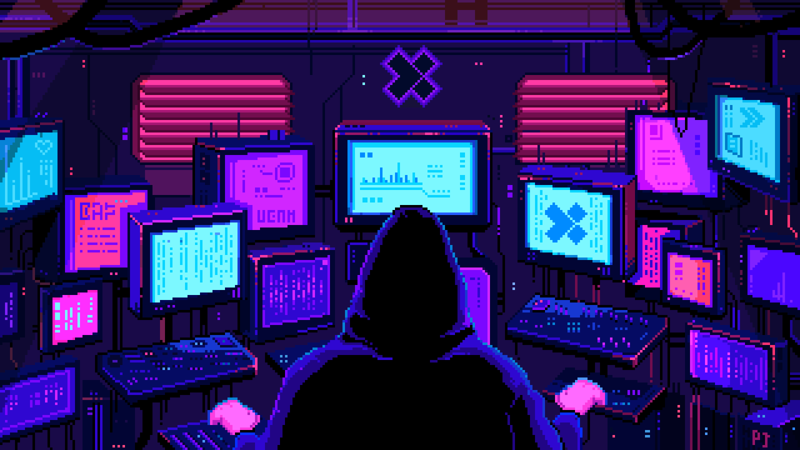

# Eae, como vai? 👋

Me chamo João Gabriel e sou estudante de **Ciência da Computação**, com foco principal em **Engenharia de IA**.
Tenho interesse em desenvolver soluções com **RAG**, **LLMs locais** e aplicações web, transformando aprendizado técnico em projetos práticos. Também exploro **cibersegurança** e **desenvolvimento full-stack**.

**• 🧠 Desenvolvendo em IA: LLMs locais, RAG, embeddings e LangChain**  
**• ⚙️ Base técnica: Python, C, JavaScript, TypeScript, React e desenvolvimento web**  
**• 🔬 Foco: transformar aprendizado com IA em projetos práticos e bem documentados**  
**• 🛡️ Segurança: foco em Blue Team e defesa de sistemas**

---

## Áreas de interesse

  
  
  
  

## Tecnologias que utilizo

<table align="center">
  <tr>
    <td align="center" width="90">
       
      Python
    </td>
    <td align="center" width="90">
       
      C
    </td>
    <td align="center" width="90">
       
      JavaScript
    </td>
    <td align="center" width="90">
       
      TypeScript
    </td>
    <td align="center" width="90">
       
      React
    </td>
    <td align="center" width="90">
       
      HTML5
    </td>
    <td align="center" width="90">
       
      CSS3
    </td>
  </tr>
</table>

  
  
  
  
  
  

---

## Projeto em destaque

### [RAG semântico para a documentação do HTTPX](https://github.com/Kamazn/Rag_Joao_Gabriel_Goncalves)

Sistema de recuperação de informações HTTPX dividido em dois módulos: **indexação** e **consulta**.

- Divide os documentos em chunks e gera embeddings para cada trecho.
- Armazena os embeddings e seus respectivos contextos no ChromaDB.
- Transforma a pergunta do usuário em embedding e busca os três trechos mais similares.
- Envia o contexto recuperado para um LLM local, ajudando a gerar uma resposta mais precisa.

**Tecnologias:** Python, LangChain, ChromaDB, embeddings, chunking, e LLMs locais.

  

---

## Aprendendo atualmente

  
  
  
  

  

